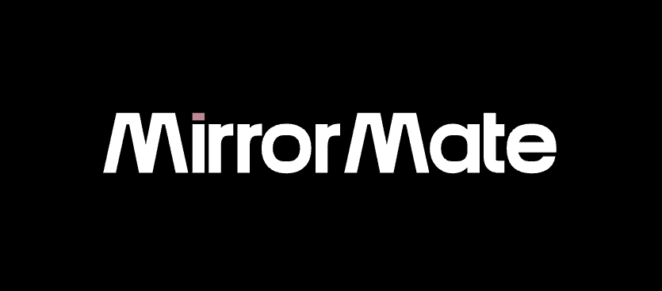

<p align="center">
  
</p>

# MirrorMate

[](https://github.com/free-programmers/MirrorMate/actions/workflows/ci.yml)
[](https://github.com/free-programmers/MirrorMate/releases)
[](https://www.python.org/downloads/)

MirrorMate is a safe mirror switcher for APT, PyPI, NPM, Go, Docker, and Homebrew. It has a shared Python core, an automation-friendly CLI, and a lightweight curses TUI. Linux and macOS use only the Python standard library at runtime; Windows also installs `windows-curses` for the TUI.

**Version 2.1.0** adds macOS and Windows support, Homebrew mirrors, and platform
managers for installation, updates, removal, and status. See the
[changelog](CHANGELOG.md) and [2.1.0 release notes](.github/release-notes/v2.1.0.md).

<p align="center">
  
</p>

<p align="center"><sub>One real TUI session: browse mirrors, run live HTTP speed tests, compare results, and switch themes.</sub></p>

## TUI preview

MirrorMate includes persistent TUI settings and a multi-theme interface. Users can control automatic speed tests, request attempts, timeouts, mirror sorting, and the active color theme from inside the application.

<table>
  <tr>
    <th width="50%">Mirror dashboard</th>
    <th width="50%">Live speed-test results</th>
  </tr>
  <tr>
    <td></td>
    <td></td>
  </tr>
  <tr>
    <th>Persistent settings</th>
    <th>Built-in theme selector</th>
  </tr>
  <tr>
    <td></td>
    <td></td>
  </tr>
  <tr>
    <th>Forest theme</th>
    <th>Violet theme</th>
  </tr>
  <tr>
    <td></td>
    <td></td>
  </tr>
</table>

## Features

- Opens the TUI when `mirrormate` is run in an interactive terminal.
- Provides non-interactive commands for servers, scripts, CI, and Docker builds.
- Benchmarks real HTTP repository endpoints instead of relying on ICMP ping.
- Supports traditional APT `.list` files and deb822 `.sources` files.
- Preserves third-party APT repositories and unrelated Docker daemon settings.
- Uses atomic writes and rolls back the current operation when validation fails.
- Creates persistent, restorable snapshots only when `--backup` is requested.
- Ships a small official catalog and supports custom mirrors from a local or remote JSON file.

Officially tested distributions:

- Ubuntu 22.04, 24.04, and 26.04
- Debian 12 and 13

Python 3.10 or newer is required.

macOS supports the CLI and curses TUI for Python/PyPI, NPM, Go, and Homebrew, including
benchmarking, dry runs, backups, and restore. APT and Docker configuration are
Linux-only and are hidden from the macOS dashboard. On Mac, configure Docker
registry mirrors in Docker Desktop **Settings > Docker Engine**, then select
**Apply & restart**.

Windows supports Python/PyPI, NPM, and Go mirror configuration, benchmarking,
dry runs, backups, and restore. APT, Homebrew, and Docker daemon configuration
are unavailable on Windows. Configure Docker Desktop through its own settings.
The Windows TUI uses the automatically installed `windows-curses` package.

| Service | Ubuntu / Debian | macOS | Windows |
| --- | --- | --- | --- |
| Python / PyPI | Yes | Yes | Yes |
| NPM | Yes | Yes | Yes |
| Go | Yes | Yes | Yes |
| APT | Yes | — | — |
| Docker daemon | Yes | Configure in Docker Desktop | Configure in Docker Desktop |
| Homebrew bottles and API | — | Yes | — |

CI targets the Ubuntu/Debian releases above, macOS with Python 3.10, and Windows
with Python 3.12. Other Python 3.10+ versions require compatible Windows curses
wheels when installing on Windows.

## Installation

### Installer

Install on macOS or Ubuntu/Debian with one command:

```bash
curl -fsSL https://raw.githubusercontent.com/free-programmers/MirrorMate/main/install.sh | sudo bash
```

On Windows, open **PowerShell as Administrator** and run:

```powershell
& ([scriptblock]::Create((Invoke-RestMethod https://raw.githubusercontent.com/free-programmers/MirrorMate/main/manager.ps1)))
```

The installer selects `manager-mac.sh` or `manager-linux.sh` automatically.
All three managers require root/Administrator privileges and exit with an
actionable message when privileges are missing. They do not open elevation prompts.
Run the installed CLI as your normal user for Python, NPM, Go, and Homebrew settings.

On Linux, the manager downloads the latest `.deb`, verifies its SHA-256 checksum,
and installs through APT. On macOS and Windows, Python 3.10+ with venv and pip must
already be installed; the manager installs the current `main` source archive in
an isolated, machine-wide environment. It does not install Python or Homebrew.
On Windows, reopen the terminal after installation to pick up the PATH change.

| Manager | Installation location | Actions |
| --- | --- | --- |
| `manager-linux.sh` | Debian package | `install`, `update`, `uninstall`, `status` |
| `manager-mac.sh` | `/Library/Application Support/MirrorMate/venv`, command in `/usr/local/bin` | same |
| `manager.ps1` | `%ProgramFiles%\MirrorMate\venv`, Scripts directory added to machine PATH | same |

From a checkout, manage the installation with:

```bash
sudo bash manager-mac.sh update    # macOS
sudo bash manager-linux.sh update  # Ubuntu/Debian
```

```powershell
.\manager.ps1 -Action update       # Administrator PowerShell
```

Replace `update` with `status` or `uninstall` as needed. Uninstall preserves user
configuration, mirror choices, and backups. Mac and Windows managers only remove
installations marked as managed by these scripts.

The Unix bootstrap can also update or uninstall in one line:

```bash
curl -fsSL https://raw.githubusercontent.com/free-programmers/MirrorMate/main/install.sh | sudo bash -s -- update
```

`MIRRORMATE_REPOSITORY` selects a GitHub fork; `MIRRORMATE_RELEASE_URL` overrides
the Linux release asset location. `MIRRORMATE_PYTHON` selects the Mac Python
executable. User configuration remains separate from the machine-wide installation.

### macOS from source

With Python 3.10+ and git installed, use an isolated virtual environment:

```bash
git clone https://github.com/free-programmers/MirrorMate.git
cd MirrorMate
python3 -m venv .venv
.venv/bin/python -m pip install .
.venv/bin/mirrormate
```

Alternatively, with pipx installed, run `pipx install .` from the checkout and
then `mirrormate` (run `pipx ensurepath` and reopen your terminal if necessary).
Use `mirrormate status --json` to inspect the managed files.

On macOS, Go uses `~/Library/Application Support/go/env`; NPM uses `~/.npmrc`.
Pip uses `~/Library/Application Support/pip/pip.conf` when its parent directory
exists, otherwise `~/.config/pip/pip.conf`. MirrorMate also honors `GOENV` and
`NPM_CONFIG_USERCONFIG`/`npm_config_userconfig`. `GOENV=off` produces an error.
Recent pip versions also use `XDG_DATA_HOME` on macOS; MirrorMate follows that
directory when its `pip` subdirectory exists.

These are user configuration changes. Environment variables such as
`PIP_INDEX_URL`, `GOPROXY`, or `npm_config_registry`, pip virtual environment
configuration, and `PIP_CONFIG_FILE` can override them. See the
[pip configuration reference](https://pip.pypa.io/en/stable/topics/configuration/)
and [Go configuration implementation](https://go.dev/src/cmd/go/internal/cfg/cfg.go).
MirrorMate settings, catalogs, and user backups retain the paths documented below
on both Linux and macOS.

### Windows from source

With Python 3.10+ installed, a per-user development environment also works:

```powershell
git clone https://github.com/free-programmers/MirrorMate.git
cd MirrorMate
py -3 -m venv .venv
.\.venv\Scripts\python.exe -m pip install .
.\.venv\Scripts\mirrormate.exe status --json
.\.venv\Scripts\mirrormate.exe
```

Windows pip settings use `%APPDATA%\pip\pip.ini`, Go uses
`%APPDATA%\go\env`, and NPM uses `%USERPROFILE%\.npmrc`. `GOENV` and
`NPM_CONFIG_USERCONFIG` overrides are honored. MirrorMate's own settings and catalog
use `%USERPROFILE%\.config\mirrormate`, and user backups use
`%USERPROFILE%\.local\state\mirrormate\backups`. System catalogs use
`%PROGRAMDATA%\MirrorMate\catalog.json` and require Administrator privileges to edit.

### Homebrew mirrors on macOS

The **HOMEBREW** dashboard category manages bottle downloads and an optional API
mirror. Changes are written to Homebrew's per-user `~/.homebrew/brew.env`, or
`$XDG_CONFIG_HOME/homebrew/brew.env` when set (`HOMEBREW_XDG_CONFIG_HOME` is also
honored as a fallback). No sudo or shell startup edits are needed; settings apply
to the next `brew` command. Install Homebrew separately if it is not installed.

Preview and apply a custom mirror (replace the example URLs with your provider's
bottle and API endpoints):

```bash
mirrormate set homebrew --url https://mirror.example.com/homebrew-bottles \
  --api-url https://mirror.example.com/homebrew-bottles/api --dry-run
mirrormate set homebrew --url https://mirror.example.com/homebrew-bottles \
  --api-url https://mirror.example.com/homebrew-bottles/api --backup
mirrormate status homebrew --json
```

Omitting `--api-url` preserves the existing API setting. To select Homebrew's
official bottle and API endpoints again:

```bash
mirrormate set homebrew --mirror homebrew-official --backup
```

Custom mirrors can be saved with `mirrormate catalog add homebrew --id my-brew
--name "My Homebrew mirror" --url URL --api-url API_URL --probe-url BOTTLE_PROBE_URL`,
or added through the TUI. Provide a real bottle endpoint as `--probe-url` to enable
speed tests and `--fastest`; entries without a probe are reported as untested
candidates with an error explaining the missing URL. If an API mirror is supplied,
the benchmark also checks its `/formula/zlib.json` endpoint. The official bottle
probe checks registry reachability and accepts its normal HTTP 401 authentication
challenge; it does not verify a complete authenticated bottle download.

Backups use the existing user snapshot directory and `backups restore ID` command.
Unrelated `brew.env` settings are preserved. Homebrew Git remotes, taps, cask/source
downloads, and artifact proxy settings are managed separately. In particular,
`HOMEBREW_ARTIFACT_DOMAIN` or administrator policy can override the bottle choice;
`status` reports the managed user file. Homebrew may fall back to official sources
if a mirror is unavailable. See [Homebrew's environment settings](https://docs.brew.sh/Manpage#environment).

### Debian package

Download `mirrormate_all.deb` and its checksum from GitHub Releases, verify it, then install it:

```bash
sha256sum --check mirrormate_all.deb.sha256
sudo apt-get install ./mirrormate_all.deb
```

There is currently no hosted MirrorMate APT repository, so `apt-get install mirrormate` by itself is not advertised.

### From source

```bash
git clone https://github.com/free-programmers/MirrorMate.git
cd MirrorMate
PYTHONPATH=src python3 -m mirrormate --help
```

The old entrypoint remains as a temporary compatibility shim:

```bash
./script.sh
```

## TUI

Run MirrorMate without arguments in an interactive terminal:

```bash
mirrormate
```

You can also request it explicitly:

```bash
mirrormate tui
```

The TUI includes a color dashboard and a live mirror table. Each HTTP result is shown as soon as it completes, healthy mirrors are ranked by median response time, and the fastest candidate is highlighted. The test checks a real endpoint for the selected package service rather than ICMP ping, so the result is closer to actual repository availability.

Mirror-list shortcuts:

- `r`: test every mirror in the current list concurrently
- `p`: test only the selected mirror
- `f`: test when needed, then select and apply the fastest healthy mirror
- `s`: open speed-test settings
- Arrow keys or `j`/`k`: move through the list
- Enter: open actions for the selected mirror
- `q` or Escape: go back

The Settings screen includes five built-in color themes: **Ocean**, **Forest**, **Amber**, **Violet**, and **Monochrome**. A selected theme is applied immediately and works with both basic 8-color terminals and richer 256-color terminals. The same screen can enable or disable automatic testing whenever a mirror list opens, choose one, three, or five requests per mirror, set the request timeout, and choose between catalog order and fastest-first sorting.

Settings are saved automatically in `~/.config/mirrormate/settings.json`; Ocean is the default theme and automatic testing is disabled by default to avoid unexpected network traffic.

The TUI can also apply a selection, import or add custom mirrors, inspect the active configuration, and restore backups.

When stdin or stdout is not a terminal, running with no arguments prints help and exits with status 2 instead of waiting for input.

## CLI

List available mirrors and inspect current configuration:

```bash
mirrormate list
mirrormate list apt --distro debian
mirrormate status
mirrormate status python --json
```

Benchmark without changing anything:

```bash
mirrormate benchmark python
mirrormate benchmark apt --distro ubuntu --json
```

Apply a catalog mirror, direct URL, or the fastest healthy candidate:

```bash
mirrormate set python --mirror pypi-official
mirrormate set python --url https://mirror.example.ir/pypi/simple
mirrormate set python --fastest --backup

sudo mirrormate set apt --distro debian --fastest --backup
sudo mirrormate set apt \
  --distro debian \
  --url https://mirror.example.ir/debian \
  --security-url https://mirror.example.ir/debian-security \
  --make-backup
```

`--make-backup` is an alias for `--backup`. A direct APT `--url` changes archive entries only; security entries stay unchanged unless `--security-url` is also supplied.

Preview exact file changes:

```bash
mirrormate set python --mirror pypi-official --dry-run
sudo mirrormate set apt --distro ubuntu --mirror ubuntu-official --dry-run
```

APT refreshes package metadata after a successful change. `--no-refresh` skips that validation for controlled environments. Docker configuration is validated and the active daemon is reloaded when possible; MirrorMate never forces a Docker restart.

APT and Docker changes require root. User-level Python, NPM, and Go changes do not. A CLI command never opens a sudo prompt; rerun a system command with `sudo` when instructed. The TUI offers sudo only after you confirm a system-level change.

## Custom catalogs

The built-in read-only catalog contains official endpoints only. Custom entries are stored in:

- User: `~/.config/mirrormate/catalog.json`
- System: `/etc/mirrormate/catalog.json` when `--system` is used

Manage entries from the CLI:

```bash
mirrormate catalog list
mirrormate catalog add python \
  --id iran-pypi \
  --name "Iran PyPI" \
  --url https://mirror.example.ir/pypi/simple

mirrormate catalog add apt \
  --id iran-debian \
  --name "Iran Debian" \
  --distro debian \
  --archive-url https://mirror.example.ir/debian \
  --security-url https://mirror.example.ir/debian-security

mirrormate catalog import ./mirrors.json
mirrormate catalog import https://example.ir/mirrors.json
mirrormate catalog remove iran-pypi
```

Remote catalogs must use HTTPS unless `--allow-http` is explicitly supplied. Imports are validated before an atomic save. Duplicate IDs fail unless `--replace` is used, and built-in IDs cannot be replaced.

Canonical catalog format:

```json
{
  "schema_version": 1,
  "mirrors": [
    {
      "id": "company-pypi",
      "type": "python",
      "name": "Company PyPI",
      "url": "https://packages.example.com/pypi/simple",
      "probe_url": "https://packages.example.com/pypi/simple/pip/"
    },
    {
      "id": "company-debian",
      "type": "apt",
      "name": "Company Debian",
      "distro": "debian",
      "archive_url": "https://packages.example.com/debian",
      "security_url": "https://packages.example.com/debian-security"
    }
  ]
}
```

The old top-level array format in `mirros/mirrors.json` is accepted during import and converted to the new schema. It is no longer downloaded automatically on every run.

## Backup and restore

Persistent snapshots are opt-in:

```bash
mirrormate set npm --mirror npm-official --backup
mirrormate backups list
mirrormate backups restore 20260904T120000Z-a1b2c3
```

For an offline APT recovery, `mirrormate backups restore ID --no-refresh` restores the files without running `apt-get update`.

User configuration snapshots are stored below `~/.local/state/mirrormate/backups`. APT and Docker snapshots are stored below `/var/lib/mirrormate/backups` and require root to restore.

Each manifest records checksums, ownership, permissions, and whether a target originally existed. Restore therefore removes files that were created by the original operation when appropriate.

Even without `--backup`, MirrorMate holds an in-memory transaction snapshot while applying a change. A failed APT refresh or Docker validation restores all files touched by that operation.

## Dockerfiles

APT, Python, NPM, and Go commands are non-interactive and can be used in a Dockerfile after MirrorMate is installed:

```dockerfile
RUN mirrormate set python --url https://mirror.example.ir/pypi/simple

RUN mirrormate set apt \
      --distro debian \
      --url https://mirror.example.ir/debian \
      --security-url https://mirror.example.ir/debian-security \
      --no-refresh \
    && apt-get update
```

For reproducible builds, prefer an explicit mirror ID or URL over `--fastest`.

Docker registry mirrors are a setting of the host Docker daemon. Running `mirrormate set docker` inside a Dockerfile cannot change the daemon that is building the image; run it on the Docker host instead.

## Exit codes

| Code | Meaning |
| ---: | --- |
| 0 | Success |
| 2 | Invalid command, catalog, or unsupported platform |
| 3 | No eligible or reachable mirror |
| 4 | Configuration, validation, or command failure |
| 77 | Root or Administrator permission required |
| 130 | Interrupted by the user |

## Development

Run the standard-library test suite:

```bash
PYTHONPATH=src python3 -m unittest discover -s tests -v
```

On Windows, install the package first so the TUI dependency is available:

```powershell
py -3 -m pip install .
$env:PYTHONPATH = 'src'
py -3 -m unittest discover -s tests -v
```

Build the architecture-independent Debian package:

```bash
sh scripts/build-deb.sh
```

Regenerate the README screenshots, GIF, and video with the real TUI in a temporary profile (requires Pillow, pexpect, DejaVu Sans Mono, and FFmpeg):

```bash
PYTHONPATH=src python3 scripts/record-demo.py
```

CI includes Windows tests, installed CLI checks, and PowerShell syntax validation.
It also runs tests and installation smoke checks on macOS, plus tests and package
smoke checks on the supported Ubuntu and Debian releases.

Release tags must match the package version, for example `v2.1.0`. The release
workflow tests Linux, macOS, and Windows before building the Debian package,
Python wheel, and source distribution. It publishes those artifacts, checksums,
and manager scripts using `.github/release-notes/v2.1.0.md` as the release body.
Changing the version and pushing code alone does not publish a GitHub Release.

## License

MirrorMate is released under the [GNU General Public License v3](LICENSE).
